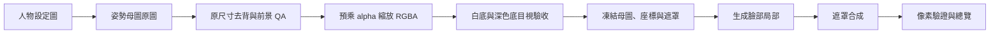

# Expression Portrait Generation

把人物設定圖製作成可切換的遊戲對話立繪：**固定姿勢母圖、局部表情生成、半透明去背、遮罩合成與像素驗證**。

A Codex skill for fixed-composition dialogue portraits, with local expression patches and foreground-preserving chroma matting.

## 能做什麼

- 提供完整 01–60 表情清單，包含情緒、眼型、嘴型及必要手勢，也可只製作指定子集。
- 一般表情共用同一張 RGBA 母圖；扶額、舉牌、托腮等手勢建立獨立姿勢組。
- 每張差分從所屬母圖直接合成，檢查遮罩外全部 RGBA 通道完全相同。
- 一般臉部差分沿用母圖 alpha，交付 720×720 透明 PNG 與可選綠幕版本。
- 附帶修正版 Deback 去背 CLI、固定遮罩合成工具與不呼叫生圖服務的測試。

## 快速開始

需要可使用圖片生成／編輯工具的 Codex 環境、Node.js 20.9 以上（建議 24），以及 Python 3.10 以上。

1. 從本專案的 **Releases** 下載技能 ZIP 並解壓，保留資料夾結構。
2. 在含 `package.json` 的資料夾安裝依賴：

```powershell
npm ci
python -m pip install -r requirements.txt
```

3. 放入自己有權使用的人物設定圖，例如 `character.png`，在 Codex 開啟該資料夾並輸入：

```text
請讀取 SKILL_New.md 與 character.png，製作完整 01–60 表情立繪。
先保留生圖原尺寸，完成姿勢母圖去背與前景保存 QA，再縮放 RGBA；
檢查白底／深色底後才凍結母圖。
依固定母圖＋臉部局部差分流程，先試作 24 驚訝並驗收，再擴充全套。
相同姿勢組的遮罩外 RGBA 像素必須完全不變，普通臉部差分保留母圖 alpha。
交付 720×720 透明 PNG、綠幕版、總覽、實際提示與 QA 紀錄。
```

`SKILL.md` 與 `SKILL_New.md` 內容相同；前者是標準技能入口，後者保留既有使用方式。這個壓縮包提供技能與處理工具；圖片由目前環境可用的生圖工具生成。

若要安裝為可發現的 Codex 技能，可把本資料夾放入專案的 `.agents/skills/expression-portrait-generation/`，保留內部相對路徑，再依環境顯示的技能入口使用。也可繼續採用上面的明確讀取方式。[官方技能文件](https://learn.chatgpt.com/docs/build-skills)

## 工作流程



同姿勢組需要符合：

```text
final[mask == 0] == base[mask == 0]
outside_mask_changed_pixels == 0
alpha_changed_pixels == 0       # 普通臉部差分
```

去背 alpha 決定人物輪廓；表情編輯遮罩決定哪些臉部像素可改。兩者用途不同。母圖去背驗收後只處理一次，後續表情共用它的 alpha。

## 去背工具

對新姿勢的原始綠幕圖執行：

```powershell
node scripts/prepare_matted_pose.cjs raw_chroma/base_01.png candidates/base_01_rgba.png matting-temp/base_01
```

此命令在原尺寸去背，前景保存檢查通過後，使用預乘 alpha 縮放 RGBA，產生 720×720 候選。`needs-visual-review` 表示仍須檢查白底、深色底、髮絲、下顎、衣物與手指，通過後才接受。

多個姿勢可執行：

```powershell
node scripts/remove_expression_backgrounds.cjs raw_chroma candidates matting-temp --prepare-poses
```

工具預設使用 `#00ff00` 綠幕、不侵蝕 alpha，並保護可信前景原色。偵測到明顯誤刪、核心透明度損失、可信前景改色或強溢色時，去背 CLI 以非零退出碼阻擋；候選仍會保留以供診斷。其他色鍵、三張中間遮罩與詳細選項見 [去背說明](references/image-matting.md)。

## 局部合成

`scripts/compose_expression_patch.py` 提供三個子命令：

| 命令 | 用途 |
|---|---|
| `prepare` | 凍結母圖、局部座標、灰階遮罩與檔案雜湊。 |
| `compose` | 把局部圖合成回母圖，輸出透明 PNG、可選綠幕及驗證 JSON。 |
| `verify` | 獨立檢查候選圖是否符合固定遮罩契約。 |

局部圖定位、遮罩格式、完整命令及手指遮擋處理見 [局部差分流程](references/local-expression-diffs.md)。表情編號見 [01–60 清單](references/expression-catalog-60.md)。

## 驗證與打包

```powershell
npm run test:matting
python -m unittest discover -s scripts -p "test_compose_expression_patch.py" -v
python scripts/make_release.py
```

測試使用合成色塊、細線與局部圖片，不呼叫任何生圖 API。打包命令在 `dist/` 產生技能 ZIP 與 SHA-256 檢查碼；以明確檔案清單打包，不包含安裝依賴或生成產物。

## 輸出結構

```text
output/expression-portraits/<reference_stem>/
  pose_templates/        已驗收並凍結的姿勢母圖
  regions/              固定裁切座標、遮罩與契約
  patches/raw/          原始局部生成回應
  patches/aligned/      對齊後局部
  transparent/          透明 PNG 成品
  expressions/          綠幕派生圖
  qa/                   檢查與目視驗收紀錄
  batch_plan.md
  manifest.md
  contact_sheet.png
```

## 實際限制

- 像素驗證能證明修改範圍，表情、接縫、手指與去背仍需要目視檢查。
- 去背 QA 是啟發式檢查；與背景接近的角色顏色、細髮絲與半透明配件要對照原圖。
- 工具沒有原生遮罩參數時，實際方法記為 `prompt-guided-patch`，最終固定構圖由確定性的遮罩合成保證。
- 2×2 批次用於局部臉部。各自重畫完整人物的四格圖不能直接通過固定差分驗收。
- 重用母圖與去背能減少重複工作；實際生成成本取決於所用工具，不承諾算力或費用節省比例。
- 圖片仍是完整 PNG；「局部差分」描述產製方式，並非遊戲引擎原生分層格式。遊戲內切換同姿勢時應保持相同原點、位置與縮放。

## 授權

技能文件與專案程式採 [MIT](LICENSE) 授權。內附第三方程式保留原授權聲明，詳見 [THIRD_PARTY_NOTICES.md](THIRD_PARTY_NOTICES.md)。

此專案不附人物設定圖或生成圖包，MIT 授權不授予這些素材的權利。使用自己有權使用的角色素材，並依來源授權處理生成結果。

版本變更見 [CHANGELOG.md](CHANGELOG.md)。
